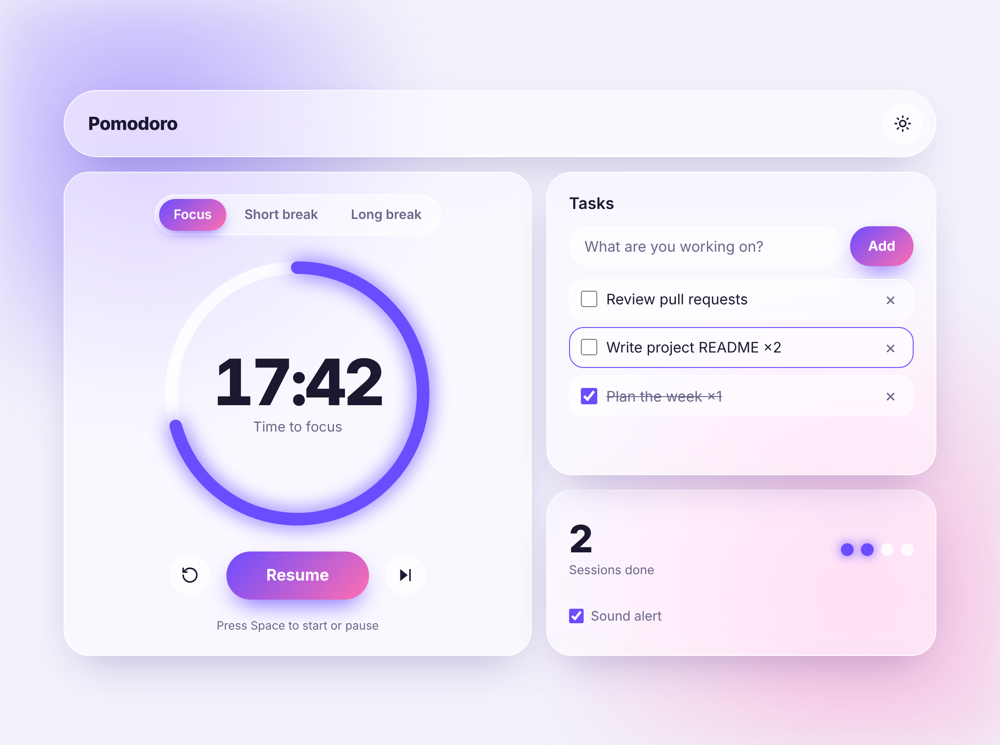
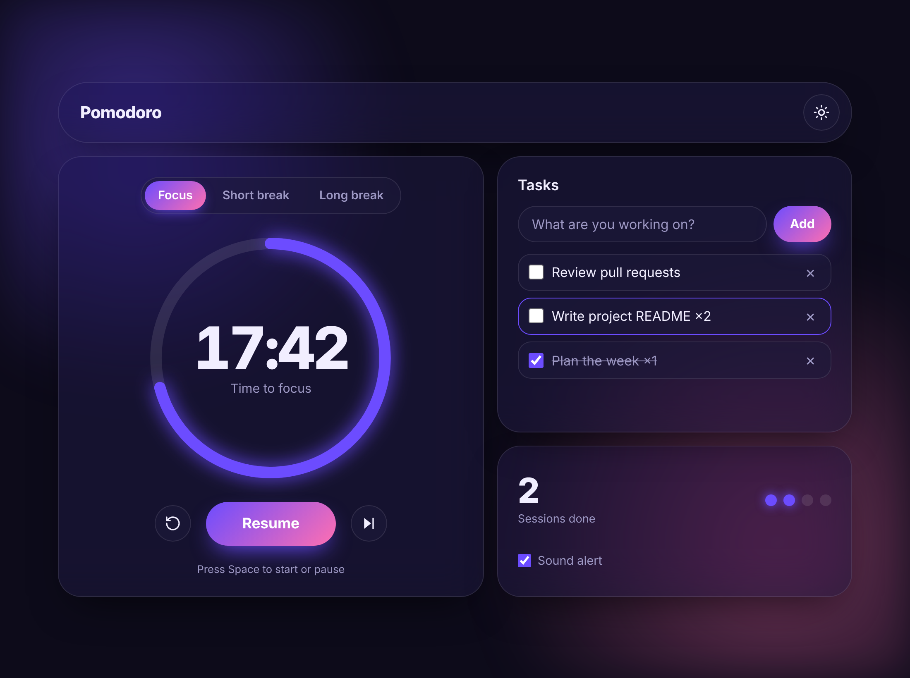

# Pomodoro Timer

A modern, stylish Pomodoro timer built with plain HTML, CSS and JavaScript. No frameworks, no build step, no dependencies. It has a glassmorphism look on a bento-grid layout, a glowing progress ring, light and dark themes, and a built-in task list.

| Light theme | Dark theme |
| :---: | :---: |
|  |  |

## Features

- **Three modes:** Focus (25 min), Short break (5 min) and Long break (15 min)
- **Automatic cycle:** a long break after every 4 focus sessions
- **Progress ring:** an animated SVG ring that fills as time passes
- **Light and dark theme:** follows your system setting and remembers your choice
- **Mode colors:** the interface changes color for focus, short break and long break
- **Sound alert:** a short chime made with the Web Audio API, so no audio files are needed (can be switched off)
- **Session counter:** completed sessions plus four dots showing progress toward the next long break
- **Task list:** add, complete and delete tasks, and pick a current task to count its finished sessions
- **Desktop notifications:** an alert when a session ends (after you allow it)
- **Live tab title:** see the remaining time without leaving your current tab
- **Accurate in the background:** the timer uses timestamps, so it stays correct when the tab is throttled
- **Keyboard shortcut:** press `Space` to start or pause
- **Responsive and accessible:** works on mobile, supports keyboard navigation and respects `prefers-reduced-motion`
- **Saved locally:** theme and tasks are stored in your browser's `localStorage`

## Getting started

1. Clone the repository:

	```bash
	git clone https://github.com/user35738/pomodoro-timer.git
	cd pomodoro-timer
	```

2. Open `index.html` in your browser.

That's all. There is nothing to install.

## Project structure

```
pomodoro-timer/
├── index.html      # Page structure
├── style.css       # Styles, themes and layout
├── script.js       # Timer logic, sound and tasks
├── favicon.svg     # App icon
└── screenshots/    # Images used in this README
```

## Customization

Session lengths and the long-break interval are set at the top of `script.js`:

```js
const DURATIONS = { focus: 25, short: 5, long: 15 }; // minutes
const LONG_BREAK_EVERY = 4;
```

Colors are CSS variables at the top of `style.css`. Change `--a` and `--b` to restyle the accent gradient for any mode or theme.

## Browser support

Works in all current versions of Chrome, Edge, Firefox and Safari. The favicon is an SVG, which modern browsers support.

## Deploy with GitHub Pages

1. Push the project to GitHub.
2. Go to **Settings → Pages**.
3. Under **Build and deployment**, choose **Deploy from a branch**, then select `main` and `/ (root)`.
4. Your timer will be live at `https://user35738.github.io/pomodoro-timer/`.

## About the Pomodoro Technique

The Pomodoro Technique was created by Francesco Cirillo. You work in focused intervals, traditionally 25 minutes, separated by short breaks, and take a longer break after several rounds. It helps you stay focused and avoid burnout.

## License

Released under the [MIT License](LICENSE). Add a `LICENSE` file to your repository, or change this section to the license you prefer.
